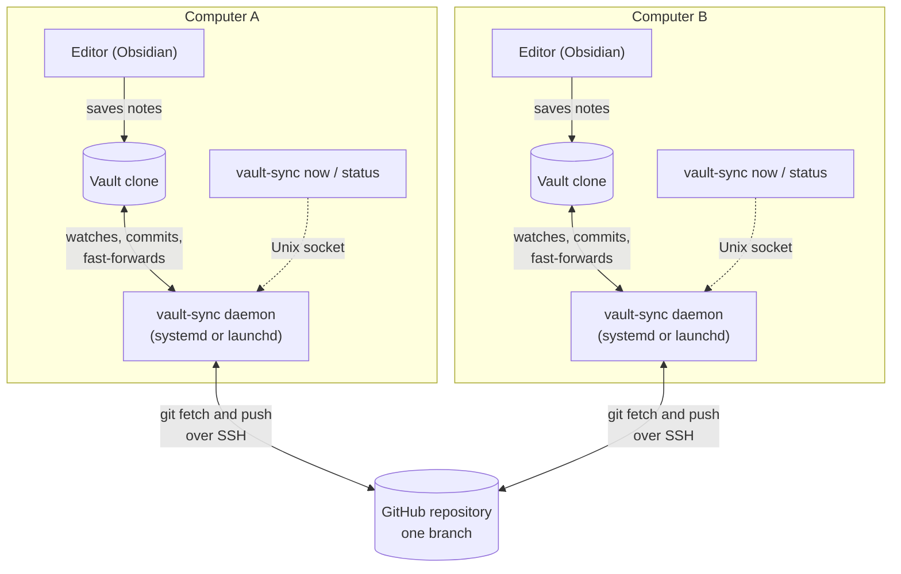
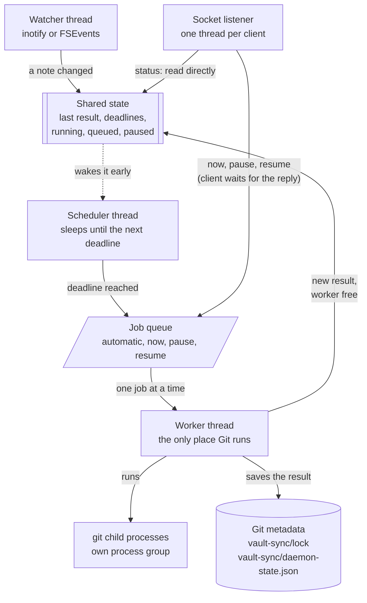
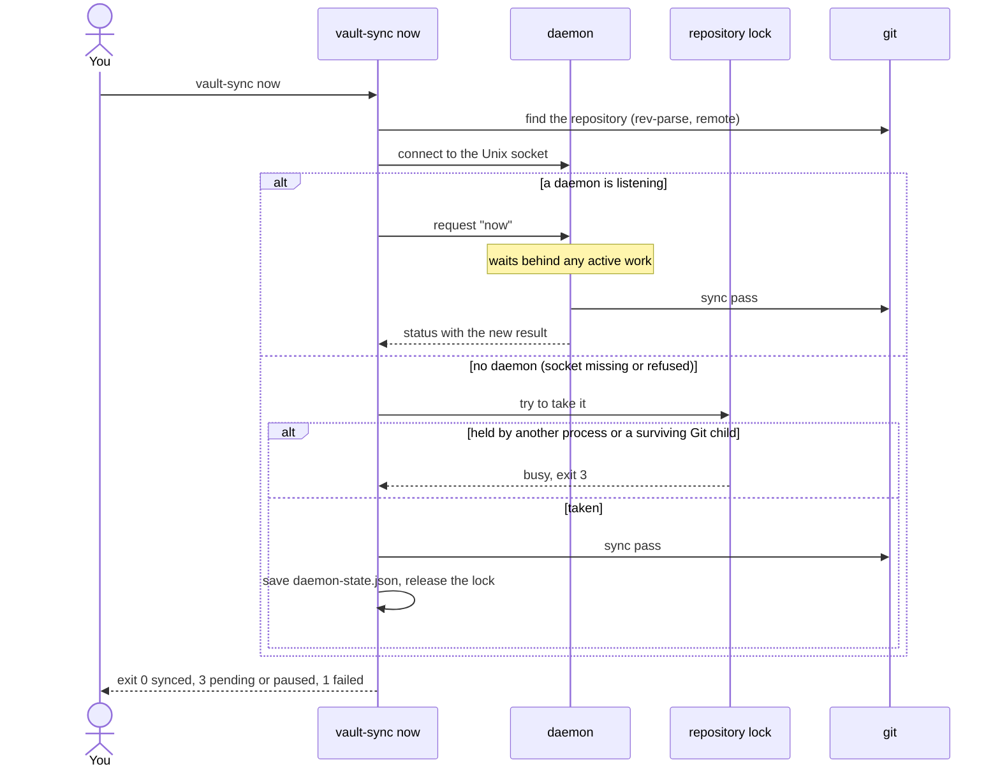
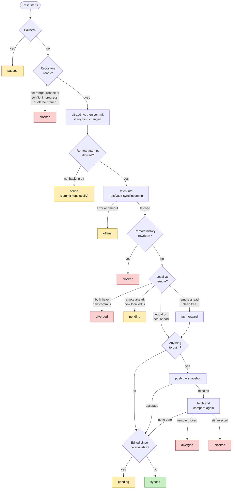
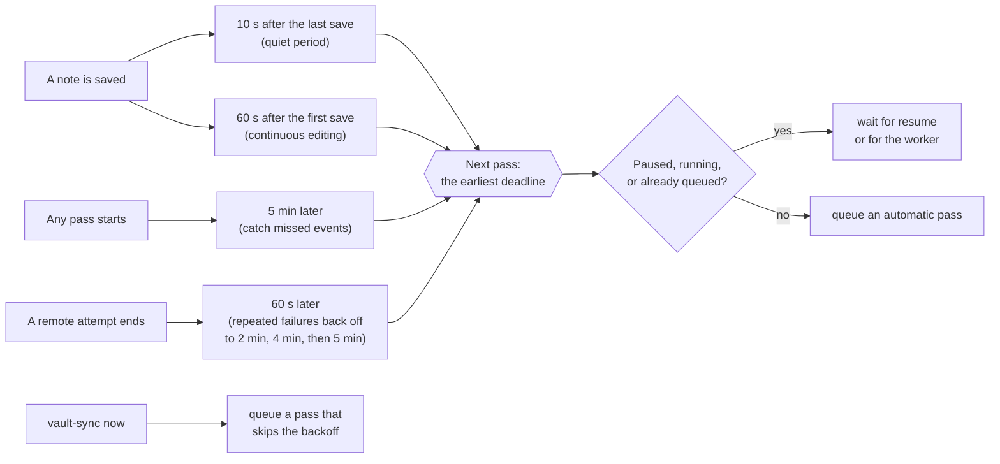
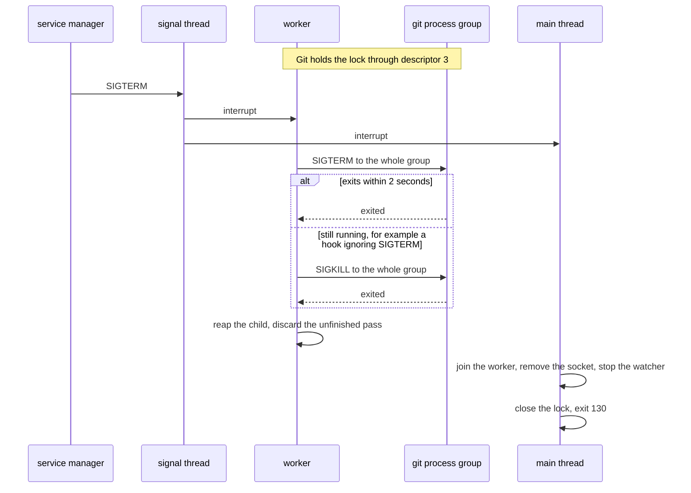
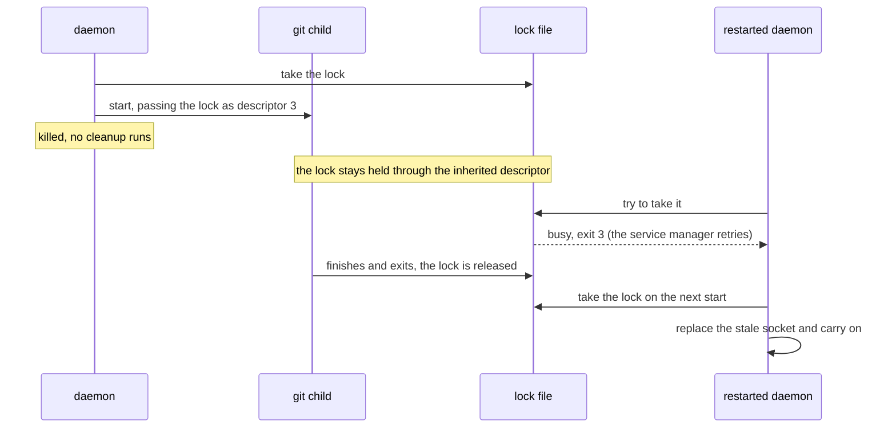
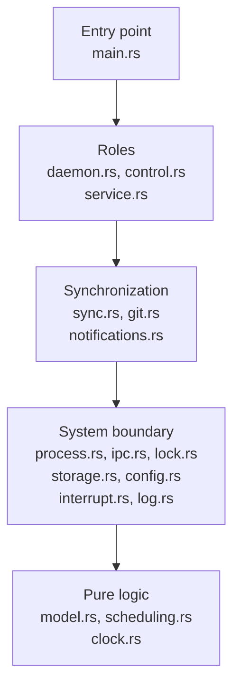

# Architecture

vault-sync is one executable with two roles. As a **daemon** it runs all day
under systemd or launchd, watching the vault and syncing it. As a **command**
(`now`, `status`, `pause`, `resume`) it asks the daemon to act, or acts by
itself when no daemon is running. Either way the work is done by running `git`;
vault-sync never talks to GitHub directly.

The diagrams go from the big picture to the details:

1. [Two computers, one remote](#1-two-computers-one-remote)
2. [Inside the daemon](#2-inside-the-daemon)
3. [What a command does](#3-what-a-command-does)
4. [One sync pass](#4-one-sync-pass)
5. [When passes run](#5-when-passes-run)
6. [Ownership and shutdown](#6-ownership-and-shutdown)
7. [Code layout](#7-code-layout)

## 1. Two computers, one remote

Each computer has its own clone and its own daemon, and the daemons never talk
to each other: the GitHub repository is the only meeting point. A daemon only
moves the branch forward. It commits local edits, fetches, fast-forwards when
the remote is ahead and pushes when it is ahead itself. It never merges,
rebases or force-pushes, so if both computers commit before either has synced,
it stops and reports **diverged** for a person to resolve.

## 2. Inside the daemon

| Thread | Job |
| --- | --- |
| Main | Starts everything, then waits; runs shutdown |
| Worker | Runs every Git command and saves every result, one job at a time |
| Scheduler | Sleeps until the earliest deadline, then queues an automatic pass |
| Watcher | Turns file events into "something changed" |
| Socket listener | Answers `status` and queues the other commands, one thread per client |
| Signals | Turns SIGINT, SIGTERM and SIGHUP into an interrupt (see [section 6](#6-ownership-and-shutdown)) |

- All Git work happens on the worker, so timers, file events and CLI commands
  can never run Git at the same time.
- The scheduler does not poll. It is woken early only when an edit starts a new
  batch or the worker becomes free, and it re-reads the clock at least every
  5 seconds, so deadlines that passed while the computer slept fire soon after
  it wakes.
- `status` is answered straight from shared state, so it responds immediately
  even during a slow fetch.
- File reads and changes inside `.git` are ignored. Otherwise Git's own
  activity during a pass would schedule another pass, forever.

## 3. What a command does

`status` takes the same path, but a daemon answers it immediately, and without
a daemon it only reads `daemon-state.json` and checks whether the lock is held.
It never takes the lock or writes anything. `pause` and `resume` wait behind
active work, then save the flag.

## 4. One sync pass

Each outcome appears next to the step that produces it, so the same outcome
can appear more than once. The remote is skipped only while backing off after
network failures; `vault-sync now` always tries it.

| Outcome | Meaning | `now` exits | Notifies |
| --- | --- | --- | --- |
| synced | The snapshot is on the remote and nothing newer is pending | 0 | No |
| pending | Synced, but newer edits appeared during the pass (or a fast-forward was deferred because of them) | 3 | No |
| paused | Automation is paused | 3 | No |
| offline | The network failed, or the pass is backing off; local commits are kept | 1 | On the third failure in a row |
| diverged | Both sides have new commits; needs a person | 1 | When it first happens |
| blocked | Anything else that needs a person: a manual Git operation, conflicts, a rewritten remote, a push the remote rejects | 1 | When it first happens |

Every outcome is saved to `daemon-state.json`. A fetch lands in
`refs/vault-sync/incoming` first, and the remote-tracking branch only advances
after the new history is checked to extend the old one; that is how a
force-pushed remote is caught before anything is built on it.

## 5. When passes run

Saving keeps pushing the quiet period back, so a burst of edits becomes one
commit; the 60-second checkpoint caps how long continuous typing can postpone
it. Remote polling exists because file events cannot see pushes from the other
computer. While the remote is failing, edits are still committed locally on
schedule; only the network attempts back off. All values are configurable in
`config.json`.

## 6. Ownership and shutdown

Only one vault-sync process may run Git in a clone at a time. That is enforced
by an OS file lock (`flock`) on `vault-sync/lock`, which every Git child
inherits as descriptor 3. The lock is released only when the last process
holding that descriptor exits, so ownership survives a crash of vault-sync
itself.

A normal stop (`systemctl stop`, Ctrl-C):

A crash or `kill -9`, where no cleanup runs:

This is why a restarted daemon or a `vault-sync now` can report *busy* for a
moment after a crash: it is waiting for the orphaned Git command, not for a
stale lock file. Never delete the lock file; its inode is what the processes
share.

## 7. Code layout

Each layer only uses layers below it (sometimes skipping one), never above.
Pure logic has no I/O and carries most of the unit tests; everything that
touches the operating system lives in the system boundary. `tests/sync.rs`
checks the compiled executable from the outside, with real Git repositories.

| Module | Responsibility |
| --- | --- |
| `main.rs` | Parses arguments, prints results, maps failures to exit codes |
| `daemon.rs` | The threads, job queue and watcher from [section 2](#2-inside-the-daemon) |
| `control.rs` | `now`, `status`, `pause`, `resume`: ask the daemon or act standalone |
| `service.rs` | Renders and installs the systemd unit or launchd agent |
| `sync.rs` | One sync pass, as in [section 4](#4-one-sync-pass) |
| `git.rs` | Repository discovery and every Git command the pass needs |
| `notifications.rs` | Decides when a result deserves a desktop notification, and sends it |
| `process.rs` | Runs a child with a timeout, an output cap and process-group cleanup |
| `ipc.rs` | The Unix socket: path, request and reply |
| `lock.rs` | Takes and checks the `flock` |
| `storage.rs` | Reads and atomically writes `daemon-state.json` |
| `config.rs` | Finds, parses and validates `config.json` |
| `interrupt.rs` | Turns signals into an interrupt that blocking work subscribes to |
| `log.rs` | Log lines on stderr for journald or launchd |
| `model.rs` | State, outcomes, failures, and the socket's wire format |
| `scheduling.rs` | Deadlines, quiet period, checkpoint and backoff |
| `clock.rs` | UTC timestamps and the local time in commit subjects |
